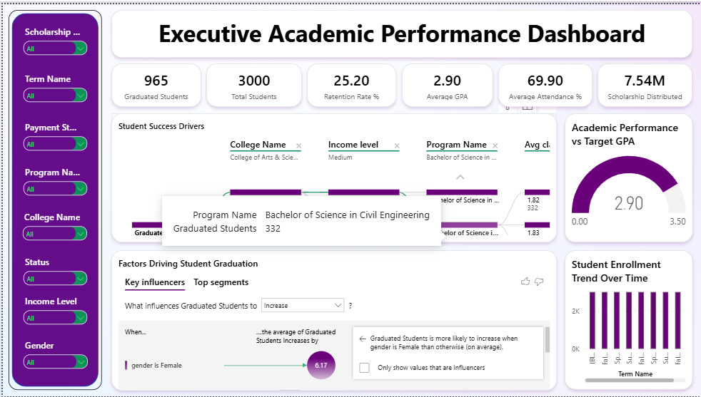

# Education Analytics Dashboard

An interactive Power BI report that tracks **student retention, graduation, academic performance, engagement, financial aid and support operations** for a university, built on a MySQL star-schema data model with 37 DAX measures.

<!-- Add a screenshot at images/dashboard-overview.png -->

---

## Table of Contents

- [Business Problem](#business-problem)
- [Key Features](#key-features)
- [Tech Stack](#tech-stack)
- [Data Model](#data-model)
- [Key DAX Measures](#key-dax-measures)
- [Report Overview](#report-overview)
- [How to Run](#how-to-run)
- [Author](#author)

---

## Business Problem

University administrators need one place to answer questions such as:

- How many students are retained, dropping out or graduating, by cohort year?
- Which students are **at risk**, and are interventions working?
- How are GPA, attendance and course pass rates changing term over term?
- How much financial aid is disbursed, and what do students still pay out of pocket?
- Which courses are over capacity, and how quickly are support tickets resolved?

This dashboard answers these questions from a single, consistent KPI layer.

## Key Features

- **Retention and graduation tracking:** Retention Rate %, Graduation Rate %, Dropout Rate % by Cohort Year
- **Early-warning view:** At-Risk Students Count and %, Intervention Success Rate %
- **Academic performance:** Average and Cumulative GPA, Pass Rate %, Course Completion Rate %
- **Term-over-term analysis:** Current vs Previous Term GPA, with change and % change
- **Engagement and attendance:** Normalised Engagement Score, Average Attendance Rate
- **Financial aid:** Total Aid Disbursed, Aid by Scholarship Type, Average Out-of-Pocket Cost
- **Capacity planning:** Average and Weighted Capacity Utilisation %, Over-Capacity Courses Count
- **Support operations:** Average Resolution Days, overall and by ticket type
- **Root-cause analysis:** Decomposition Tree and Key Influencers visuals to explore what drives retention and dropout
- **Interactive filtering:** Slicers across college, program, term and student attributes

## Tech Stack

| Layer | Tool |
|---|---|
| Visualization | Power BI Desktop |
| Data modeling | Star schema, 22 relationships |
| Calculations | DAX (37 measures) |
| Data source | MySQL (`education_analytics` database) |
| ETL | Power Query |

## Data Model

A star schema with **8 dimension tables** and **7 fact tables** (15 tables, 22 relationships).

**Dimensions**

| Table | Rows |
|---|---|
| `dim_student` | 3,000 |
| `dim_date` | 1,035 |
| `dim_course` | 20 |
| `dim_college` | 4 |
| `dim_department` | 8 |
| `dim_program` | 8 |
| `dim_instructor` | 8 |
| `dim_term` | 8 |

**Facts**

| Table | Rows |
|---|---|
| `fact_student_progression` | 24,000 |
| `fact_enrollment` | 15,000 |
| `fact_student_engagement` | 8,000 |
| `fact_financial_aid` | 3,000 |
| `fact_support_ticket` | 2,000 |
| `fact_retention` | 1,000 |
| `fact_course_performance` | 320 |

## Key DAX Measures

| Category | Measures |
|---|---|
| Retention and graduation | Retention Rate %, Graduation Rate %, Dropout Count, Dropout Rate % by Cohort Year, Graduated Students |
| Risk and intervention | At-Risk Students Count, At-Risk Students %, Intervention Success Rate % |
| Academic performance | Average GPA, Average Cumulative GPA, Overall Pass Rate %, Course Completion Rate % |
| Term comparison | Current Term Avg GPA, Previous Term Avg GPA, SoS GPA Change, SoS GPA Change % |
| Engagement | Engagement Score, Engagement Score Normalised, Average Attendance Rate |
| Financial aid | Total Financial Aid Disbursed, Total Aid by Scholarship Type, Average Out-of-Pocket Cost |
| Capacity | Avg Capacity Utilisation %, Weighted Capacity Utilisation %, Over-Capacity Courses Count |
| Support | Avg Resolution Days, Avg Resolution Days by Type |
| Volume | Total Students, Active Students Count, Total Enrollment, Total Courses |

## Report Overview

- **7 report pages** with 120+ visuals
- Visual types: KPI cards, gauges, donut and treemap charts, ribbon, area and waterfall charts, scatter plot, radar chart, calendar heatmap, pivot tables, Decomposition Tree and Key Influencers
- Slicers for drill-down by college, program, term and student attributes

## How to Run

1. Install **Power BI Desktop** and the **MySQL connector** (MySQL Connector/NET).
2. Restore the `education_analytics` database to a MySQL server. The report expects `localhost:3306`.
3. Open `Education_Analytics.pbix` in Power BI Desktop.
4. If prompted, update the data source: **Home → Transform data → Data source settings**, then enter your MySQL credentials.
5. Click **Refresh** to load the data.

## Author

**Nikita Moon**
